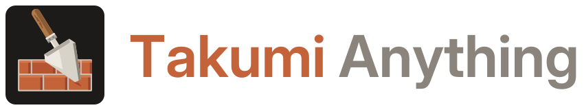
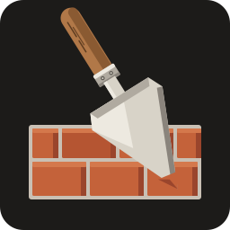
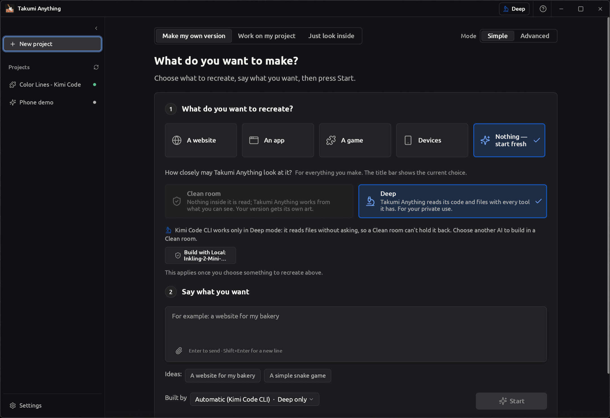
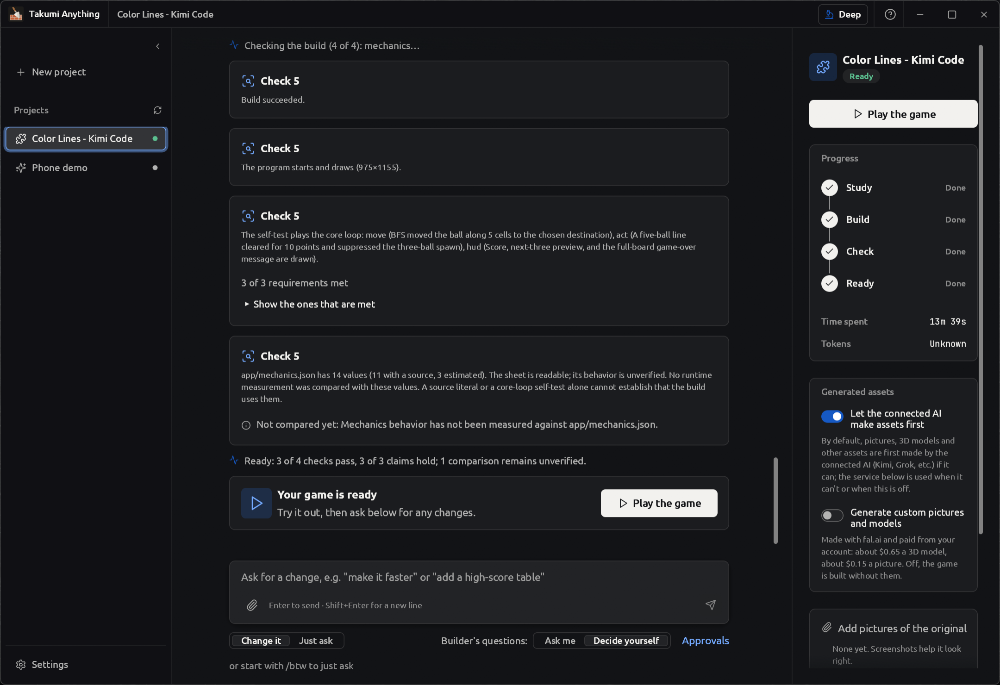
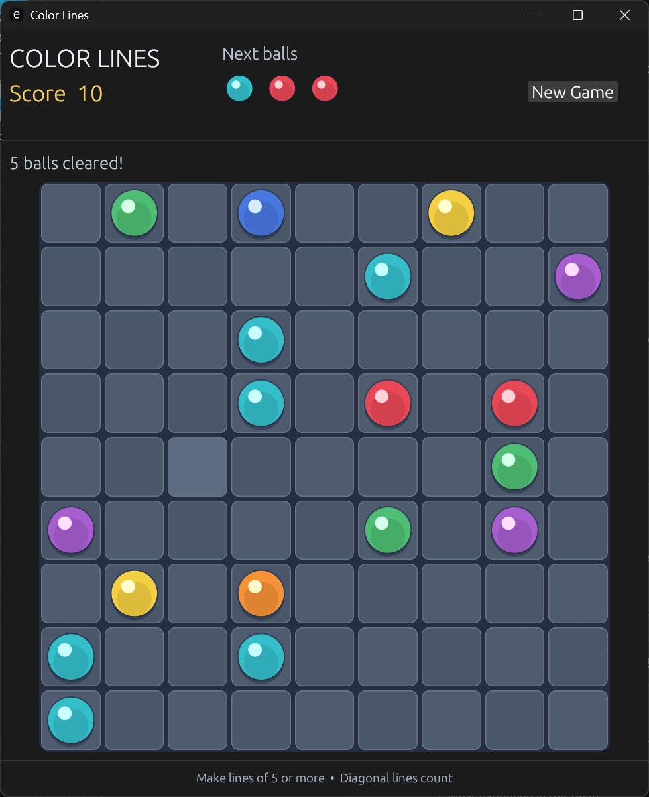
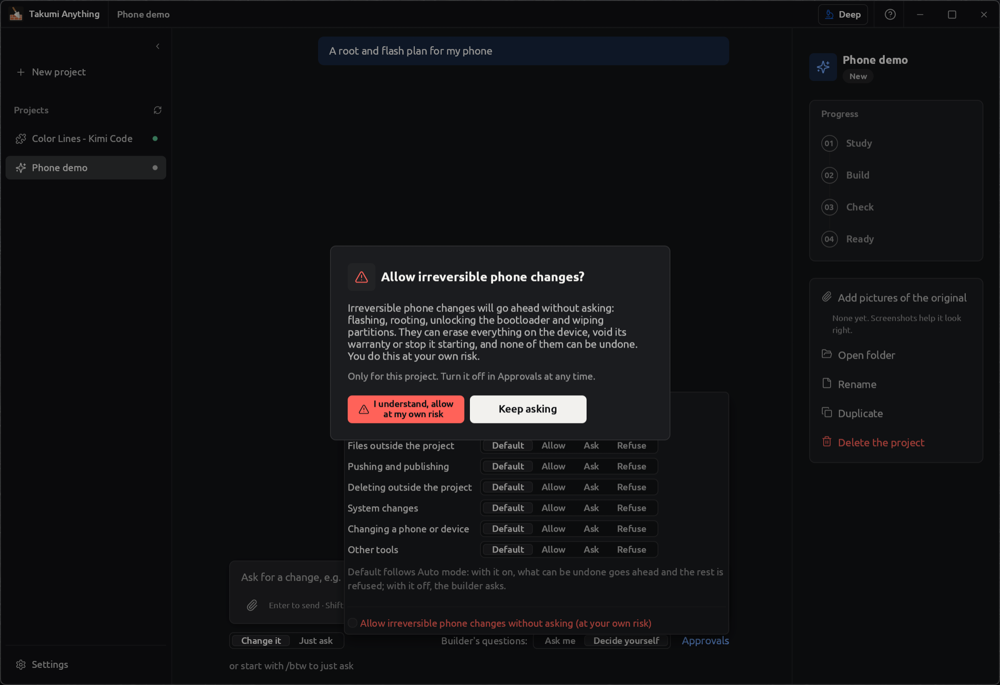

<p align="center">
  
</p>

<p align="center">
  
</p>

<h1 align="center">Takumi Anything</h1>

<p align="center">
  <b>See how any website, app or game works, then have AI build your own version.</b><br>
  Open-source reverse-engineering and rebuild workbench in Rust.<br>
  <i>Takumi</i> (匠) means master craftsman.
</p>

<p align="center">
  
  
  
</p>

> **Takumi Anything is based on [Craft Anything](https://github.com/storytold/craft-anything) by the ArtCraft team,
> modified by Aleksandr Mitroshenkov.** It is an independent, unofficial fork. It is not made,
> endorsed or supported by the ArtCraft team, and it uses none of their names, logos or icons as its own.
> Upstream license (MIT OR Apache-2.0) is kept.

## Why we made this

We downloaded the earlier Craft and found no way to connect **Kimi Code** as a builder, so we built that.
Local models were a hot topic, so we added them our way — Takumi Anything's own **llama.cpp** engine
and a Local AI tab, without importing another app's settings.

We did this before the upstream release / refactor that ArtCraft has been talking about. Treat this
repository as a **prototype or sketch of ideas**: the Craft developers may never use the code;
it is here to show what could be added.

**Provided AS IS, without warranty of any kind.** See the MIT and Apache-2.0 licenses.

## What's different from Craft Anything

| | Takumi Anything |
|---|---|
| Builders | **Kimi Code CLI**, **Grok Build**, and other Agent CLIs over ACP |
| Local AI | Settings → Local AI — the program's **own llama.cpp** (nothing sent away) |
| Devices | Phone / firmware work; red **at your own risk** only for irreversible phone actions (root, flash, unlock, wipe), off by default; CLI `--yes-irreversible` |
| Assets | By default the **connected AI** makes pictures and 3D models first; fal.ai is the fallback |
| Modes | Clean room / Deep |
| UI | Two standard button sizes; flat-vector branding (trowel and wall) |
| CLI | `takumi-anything-cli` matches the desktop app |
| Start | Starts from zero; never imports Craft Anything settings |

## Screenshots

<p align="center">
  
  <br><sub>Make: pick what to recreate, say what you want, press Start.</sub>
</p>

<p align="center">
  
  <br><sub>Color Lines built with Kimi Code — ready, with assets by the connected AI first.</sub>
</p>

<p align="center">
  
  &nbsp;
  
  <br><sub>Left: the game running. Right: irreversible phone option (red), at your own risk.</sub>
</p>

## Example: Color Lines

[`examples/color-lines`](examples/color-lines) is a classic Color Lines desktop game (9×9, eframe/egui)
**generated by Kimi Code through Takumi Anything**. License MIT OR Apache-2.0.

```sh
cd examples/color-lines && cargo run --release
```

## Build from source

Stable Rust toolchain. From the repository root:

```sh
cargo build --release -p takumi-anything -p takumi-anything-cli
cargo run --release -p takumi-anything
```

Does **not** replace Craft Anything and never reads `%APPDATA%\craft-anything`.

## Status

Experimental fork / early prototype. Used daily on Windows 11. macOS, Linux and FreeBSD packaging
is inherited from upstream and untested here.

**Responsible use.** Use Takumi Anything on software you own or are allowed to examine. It never
bypasses DRM, logins or anti-cheat.

## Support

If you'd like to help: donations cover the AI tokens and time spent building this.

Donations (TRON TRC-20, USDT or TRX): `TYveZBXaSpM4FEHa6iGrc7A6zuLfS4z3x6`

Send only via the TRON (TRC-20) network; other networks lose funds permanently.

## License and credits

Dual-licensed under [MIT](LICENSE-MIT) or [Apache-2.0](LICENSE-APACHE), at your option — same as
[Craft Anything](https://github.com/storytold/craft-anything).

Based on Craft Anything by the ArtCraft team: Copyright (c) 2026 ArtCraft Team and the Craft Anything
contributors ([CONTRIBUTORS.md](CONTRIBUTORS.md)). Modifications Copyright (c) 2026 Aleksandr
Mitroshenkov. Notices: [NOTICE](NOTICE). Bundled fonts and icons: [ATTRIBUTION.md](ATTRIBUTION.md).

"Craft Anything" and "ArtCraft" name the original project and its makers only. The Takumi Anything
icon and wordmark are original work for this fork (`assets/app-icon/LICENSE.txt`).

See also [CHANGES.md](CHANGES.md) for a detailed changelog of the fork.
