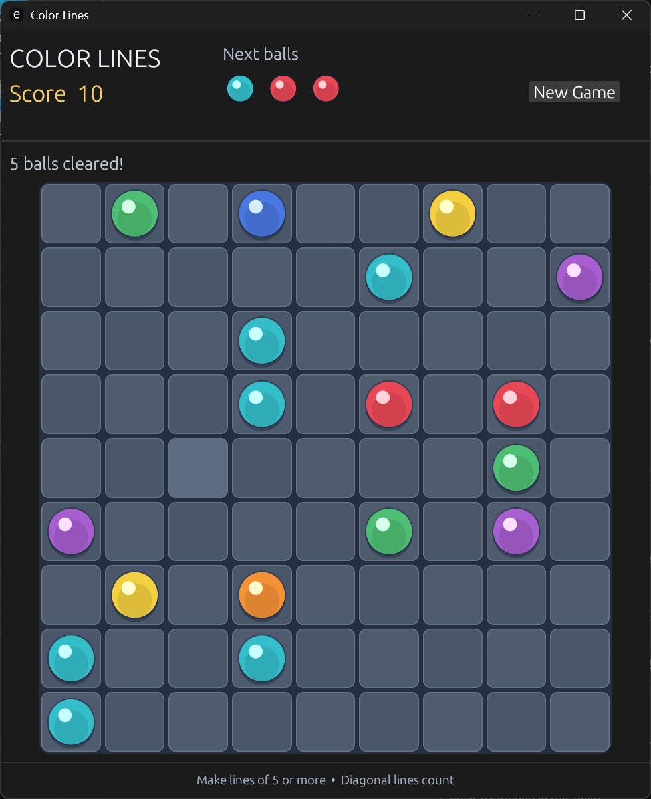

# Color Lines

The classic Color Lines puzzle in Rust, as a desktop window (eframe/egui) with an English interface.

- 9x9 board, 7 ball colors.
- Each turn 3 new balls appear at random; the next 3 are shown as a preview.
- Click a ball, then an empty cell: the ball moves along a free path (found with BFS), if one exists.
- A line of 5 or more balls of one color (horizontal, vertical or diagonal) clears and scores points. A move that clears a line spawns no new balls.
- The score is shown; a game-over message appears when the board is full.

Run it: `cargo run --release`

## How it was made

This example was generated by **Kimi Code** (Kimi Code CLI), driven by **Takumi Anything**
(Deep mode, "Build with: Rust"). The request was:

> Write the classic Color Lines puzzle game in Rust as a desktop window app with an English interface.
> Board 9x9, 7 ball colors. Each turn 3 new balls appear at random and the next 3 balls are shown as a
> preview. Click a ball, then click an empty cell: the ball moves along a free path found with BFS (only
> if a path exists). A line of 5 or more same-colored balls (horizontal, vertical or diagonal) clears and
> scores points, and a move that clears a line does not spawn new balls. Show the score and a game over
> message when the board is full. Use eframe/egui so that cargo run starts the game.

Takumi Anything built it, ran its checks (build, start-and-draw, a `--self-test` of the core loop), and sent
the builder back once to fix an overflow the self-test found. `MECHANICS.md` and `mechanics.json` are the
rule sheet Takumi Anything asks a builder to write. The source is Kimi's output; only the package metadata
in `Cargo.toml` (license, `publish = false`, standalone `[workspace]`) was added for this repository.

## License

MIT OR Apache-2.0, like the rest of this repository (see `LICENSE-MIT` and `LICENSE-APACHE` at the root).
